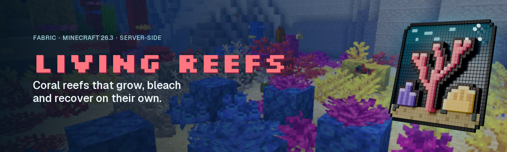
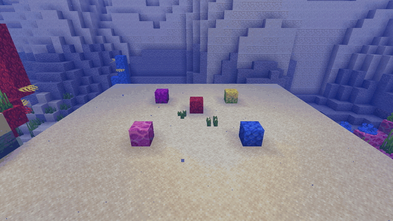
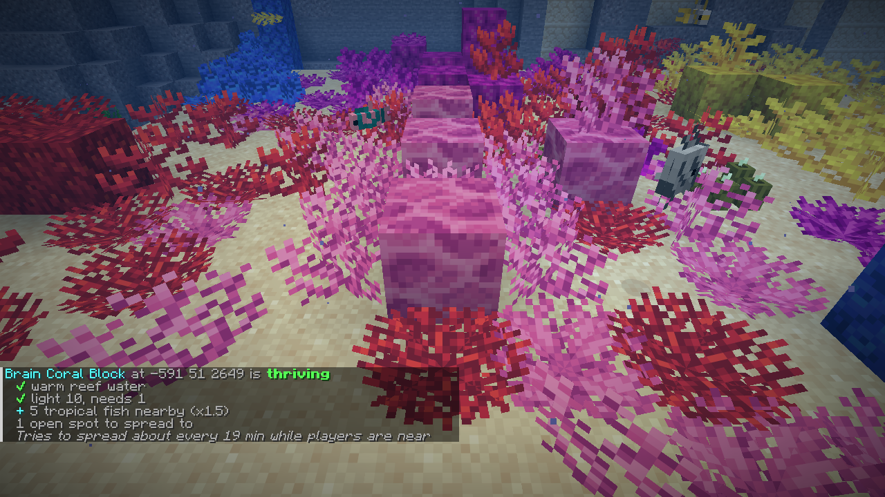
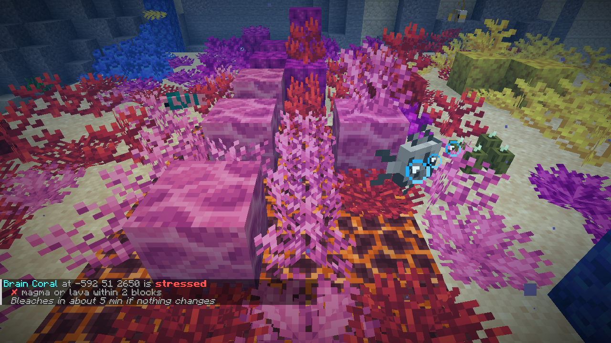
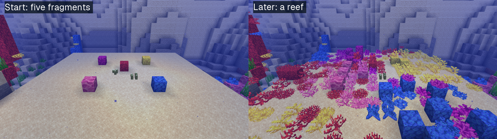
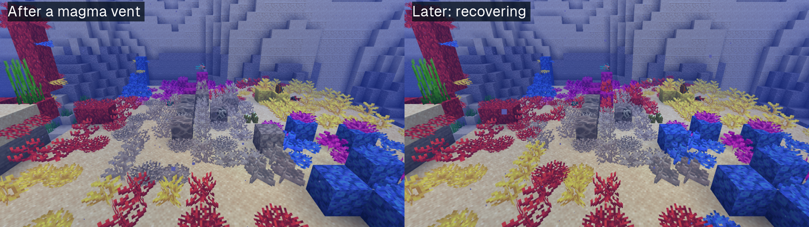
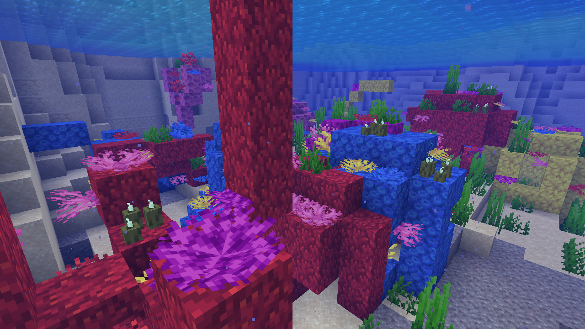
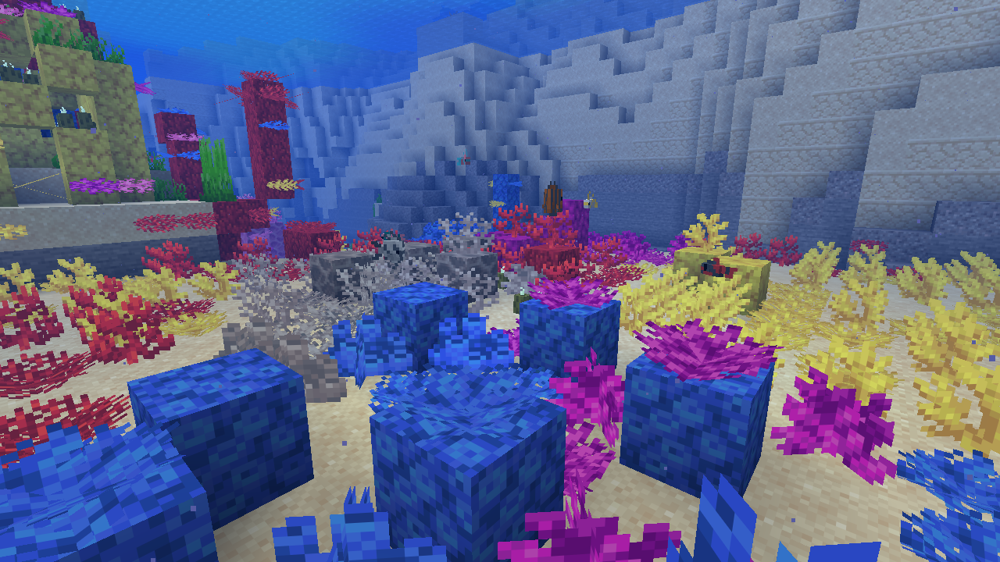
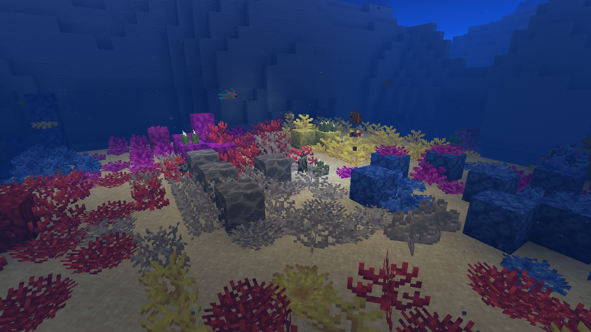

<p align="center">
  
</p>

<p align="center">
  <a href="https://github.com/razekteixeira/living-reefs/actions/workflows/build.yml"></a>
  <a href="https://www.curseforge.com/minecraft/mc-mods/living-reefs"></a>
  
  
  
  <a href="LICENSE"></a>
</p>



In vanilla Minecraft a coral reef is a painting: coral only grows from bone meal and only ever
dies. **Living Reefs makes reefs live.**

- **Coral spreads its own kind** into nearby still water: plants and fans on sand, wall fans on the
  side of a block, and new coral blocks that build the reef up to three high.
- **Reefs react to how you treat them.** Coral next to magma or lava, or in frozen water,
  **bleaches** into its dead, white twin.
- **Bleached reefs recover.** Remove the heat and thriving coral slowly takes back dead coral of
  its own kind right next to it, so you can **restore** a dead reef by planting living fragments.
- **What a reef likes:** warm water, light (sea pickles light deep reefs), tropical fish and sea
  pickles nearby, and an active **conduit**, which makes any water a reef and shelters it from
  bleaching.
- **`/reef check`** tells you why a coral is thriving, dormant or stressed.

It runs on the server only and uses vanilla coral blocks, so players join with an unmodified
client.

| `/reef check` on a thriving coral | `/reef check` next to a magma vent |
|---|---|
|  |  |

| From fragments to a reef |
|---|
|  |

| Bleached by a magma vent, then recovering |
|---|
|  |

| Natural reef | Restored reef | After dark |
|---|---|---|
|  |  |  |

Every screenshot here is a real capture from the game client, produced by
[`LivingReefsCaptures`](src/gametest/java/io/github/razekteixeira/livingreefs/gametest/client/LivingReefsCaptures.java)
on the seed `living-reefs`. The time-lapse is sped up with `random_tick_speed` and higher chances;
everything that grows is the mod's own doing. The 3D logo is rendered in Blender from the icon's
own pixels ([`branding/render_logo3d.py`](branding/render_logo3d.py)).

## How it works

Living coral gets random ticks, like grass and crops. Most ticks end after one random number; now
and then a coral reads its surroundings and acts:

| Health | When | What happens |
|---|---|---|
| **Thriving** | in reef water (warm ocean) or near an active conduit, with light of at least 1 | tries to spread (4 % per random tick, times the boosts) or to revive dead coral of its kind next to it (4 %) |
| **Dormant** | anywhere else, too dark, or sheltered by a conduit | nothing: coral in your aquarium stays as it is (unless an active conduit is near) |
| **Stressed** | magma or lava within 2 blocks, or frozen water | bleaches into its dead twin (25 % per random tick) |

At the default `random_tick_speed` of 3 a block gets a random tick about every 68 seconds, so a
thriving coral tries to spread about once every half hour, and only within simulation distance of
a player. `/tick freeze` stops it.

**How far it spreads.** Coral only spreads in warm ocean, the biome where vanilla grows reefs, or
near an active conduit. New coral only fills water source blocks on reef substrate (sand, gravel,
stone, clay, coral), never replaces a block or grows into a swimmer, keeps two blocks of water above
it, never goes where 14 coral are already within two blocks, and stacks coral blocks at most three
high. So a reef gets no denser than a natural one, but over many hours near players it does keep
creeping slowly across warm ocean floor. Coral in lukewarm, cold or any other water stays as it is, unless an active conduit is near.
Growth is a per-world game rule (`/gamerule livingreefs:coral_growth false`); it does not check
land-claim mods. Dry dead coral (decoration on land, as some worldgen mods place it) is never
revived.

**Nothing is stored on the side.** Every change is a vanilla coral block, so there is no extra save
data, and removing the mod leaves your reefs as they are.

## Commands

`/livingreefs` and the short alias `/reef` are the same command.

| Command | Permission | What it does |
|---|---|---|
| `/reef check [pos]` | use | Health of the coral you look at (or at `pos`, within 16 blocks unless admin), every condition behind it, how many open spots it can spread to, and when it will next spread or bleach |
| `/reef stats` | use | Coral random ticks, growth, recovery and bleaching since start, and the handler's own time |
| `/reef reload` | admin | Re-read `config/livingreefs.json` |

### Game rules

| Rule | Default | |
|---|---|---|
| `livingreefs:coral_growth` | `true` | spreading and recovery |
| `livingreefs:coral_bleaching` | `true` | bleaching |

### Permissions

With a permissions mod such as LuckPerms, grant `livingreefs.use` and `livingreefs.admin`. Without
one, the vanilla operator levels from the config apply: use 0, admin 3.

### Configuration

`config/livingreefs.json` is created on first start with every option. Chances are per coral
random tick.

```json
{
  "growthChance": 0.04,
  "recoveryChance": 0.04,
  "bleachChance": 0.25,
  "spreadRadius": 2,
  "minWaterAbove": 2,
  "maxNearbyCoral": 14,
  "maxReefHeight": 3,
  "minLight": 1,
  "boosts": { "tropicalFish": 1.5, "seaPickles": 1.5, "conduit": 2.0 },
  "particles": true,
  "permissionLevels": { "use": 0, "admin": 3 }
}
```

Out-of-range values are clamped with a warning in the log. A file that cannot be read is reported
and left untouched; the previous settings stay active.

### Datapack tags

| Tag | Default |
|---|---|
| `livingreefs:reef_waters` (biomes) | warm ocean |
| `livingreefs:frozen_waters` (biomes) | frozen ocean, deep frozen ocean, frozen river, `#c:is_aquatic_icy` |
| `livingreefs:reef_substrate` (blocks) | sand, red sand, gravel, clay, dirt, stone family, sandstone, every coral block |
| `livingreefs:reef_heat_sources` (blocks) | magma block, lava |

## Compatibility

- **Modded coral** works when it extends the vanilla coral blocks and follows the vanilla naming
  (`<type>_coral_block`, `<type>_coral`, `<type>_coral_fan`, `<type>_coral_wall_fan`, each with a
  `dead_` twin). Add other mods' warm ocean biomes to `livingreefs:reef_waters`.
- **Lithium:** tested with Lithium 0.26.2 on a dev server ([`tools/compat-lithium.sh`](tools/compat-lithium.sh)):
  coral kept its random ticks at the expected rate under Lithium's own random tick code and the
  reef grew. A mod that overrides the coral blocks' own `randomTick` (Nature's Spirit and
  improveMint did on older versions) would take precedence.
- **Worldgen mods** that change ocean depth are fine: the rules use light and water above the coral,
  never an absolute height.

## Performance

Measured with [`tools/benchmark.sh`](tools/benchmark.sh) on a dev server with a dense 64 x 64 reef
of 8,192 coral in warm ocean water (Apple M-series, after a 40 s warm-up, 15 readings of the
handler's own time): a median **1.9 ms per second of game time** at the default
`random_tick_speed` of 3, about 0.1 ms per tick, and 43 ms per second at a stress value of 300. `/reef stats` shows the same numbers on
your server.

## Install

Living Reefs needs Minecraft **26.3**, [Fabric Loader](https://fabricmc.net/use/) 0.19.5 or newer,
[Fabric API](https://www.curseforge.com/minecraft/mc-mods/fabric-api) and Java 25.

- **Server:** put the Living Reefs jar and Fabric API in the server's `mods/` folder.
- **Singleplayer:** install Fabric Loader for 26.3 with your launcher, then put both jars in `.minecraft/mods`.

## Building and contributing

```bash
./gradlew build              # compile, unit tests, GameTests on a headless server
./gradlew runServer          # dev server in ./run, no Minecraft account needed
./gradlew runClientGameTest  # real client: regenerates the screenshots (opens a window)
python3 -P tools/mutation.py # mutation check: every planted fault must fail a named test
```

JDK 25 is required. See [CONTRIBUTING.md](CONTRIBUTING.md) for the layout, the testing rules and
how releases work. The research behind the design is in [docs/research.md](docs/research.md), the
specification in [docs/spec.md](docs/spec.md).

## License

Apache License 2.0, see [LICENSE](LICENSE). Bundled third-party code is listed in
[THIRD_PARTY_NOTICES.md](THIRD_PARTY_NOTICES.md).

NOT AN OFFICIAL MINECRAFT PRODUCT. NOT APPROVED BY OR ASSOCIATED WITH MOJANG OR MICROSOFT.
